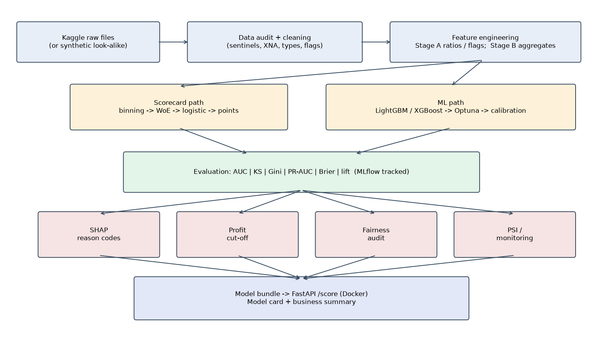

# Credit Risk Scoring with Explainability

An end-to-end, educational credit-default project built from `Credit_Risk_Scoring_Guide.md`:
a **WoE scorecard** (interpretable baseline), a **LightGBM challenger**, **probability calibration**,
**SHAP reason codes**, a **profit-maximising cut-off**, a **fairness audit**, **PSI monitoring**, and a
**FastAPI + Docker** scoring service, with tests, CI, a model card and a one-page business summary.

> **Important:** the Kaggle data could not be downloaded where this project was built, so every number shipped in
> `reports/` and `docs/` comes from a **synthetic look-alike dataset** (`src/credit_risk/synthetic.py`).
> It proves the pipeline runs end to end; it says nothing about real borrowers. Run on the real
> Home Credit files ([scripts/download_data.md](scripts/download_data.md)) and `make docs` to regenerate everything.
> Not a production lending system and not financial advice.



## Quick start (Python 3.11)

```bash
python3.11 -m venv .venv && source .venv/bin/activate
make install                 # pip install -r requirements.txt && pip install -e .
make run                     # synthetic data -> Stage A -> Stage B -> docs   (~1-2 min)
make test                    # pytest
make api                     # http://localhost:8000/docs
```

Real data: follow `scripts/download_data.md`, then `CR_DATA_SOURCE=real make run-a run-b docs`.
Docker: `make run-a && docker compose up --build` (the trained bundle in `artifacts/` is copied into the image).
Experiment tracking: `make mlflow` (SQLite store at `mlflow.db`, every Optuna trial is a nested run).

## Scoring example

```bash
curl -s -X POST localhost:8000/score -H 'content-type: application/json' -d '{
  "AMT_INCOME_TOTAL": 135000, "AMT_CREDIT": 450000, "AMT_ANNUITY": 42500,
  "EXT_SOURCE_1": 0.15, "EXT_SOURCE_2": 0.20, "EXT_SOURCE_3": 0.10,
  "DAYS_EMPLOYED": -200, "NAME_EDUCATION_TYPE": "Lower secondary"}'
```
Returns `pd`, `score`, `risk_band`, `decision`, top `reason_codes` (e.g. "Low overall external credit score"),
`model_version` and `latency_ms`. Inputs are validated (422 on bad ranges / unknown fields); the audit log
(`logs/audit.jsonl`) stores request id, version and outputs only, **no applicant data**. The API serves the
Stage A model (application-time fields only); Stage B needs history tables from a bureau/data feed.

## Results on the synthetic data (test set, 20,000 applicants, ~8% default)

| | Scorecard AUC / KS | LightGBM (calibrated) AUC / KS |
|---|---|---|
| Stage A (application only) | 0.683 / 0.286 | 0.693 / 0.313 |
| Stage B (+ history tables) | 0.735 / 0.362 | 0.745 / 0.378 |

* The scorecard-vs-GBM gap (~0.01 AUC) is inside the bootstrap confidence intervals: no real winner. History tables add ~0.05 AUC.
* **Calibration:** the class-weighted GBM chosen in Stage A over-predicted risk (mean PD 0.37 vs 0.08 observed, ECE 0.285); Platt scaling fitted on validation brings ECE to 0.009 without changing the ranking.
* **Cut-off (illustrative economics: 10% margin, 70% LGD):** approve if PD <= 13.6%, chosen on validation; on test this approves ~84% with a 6.2% bad rate among approved. The riskiest 20% of applicants hold ~43% of defaults. The profit uplift vs approve-all is a *simulation* driven by assumptions; a +/-20% sensitivity table is in `reports/results.md`.
* **Fairness** (gender excluded from the model, age features excluded by default): approval-rate disparate-impact ratios 0.998 (gender), 0.953 (age band), 0.914 (family status), none under the 0.8 four-fifths flag. On real data re-check, and have compliance review.
* **Stability:** score PSI validation-vs-test 0.002. A "shifted population" exercise (applicants under 35) gives only 0.005 because age is deliberately not a model input; PSI flags are a trigger to investigate, not proof of failure.
* **Latency** (in-process, 1 CPU sandbox, 1,000 calls): p50 26 ms, p95 29 ms. Re-measure against the container with `scripts/benchmark_api.py --url ...`.

Full tables: `reports/results.md`. Figures: `reports/figures/`.

## Repository map

| Path | What |
|---|---|
| `src/credit_risk/` | `data`, `features`, `scorecard` (own monotone WoE binner), `models`, `calibration`, `explain`, `business`, `fairness`, `stability`, `pipeline`, `reporting`, `synthetic`, `api/` |
| `notebooks/` | 7 executed notebooks (EDA, features, scorecard, GBM+calibration, SHAP, business+fairness, PSI); thin, logic lives in `src/` |
| `docs/` | `model_card.md`, `data_audit.md`, `feature_dictionary.md`, `monitoring_plan.md`, `business_summary.pdf`, `architecture.png` |
| `tests/` | 28 unit and integration tests: cleaning, leakage guard, binning monotonicity, score scaling, PSI, calibration, profit, fairness, API contract |
| `Dockerfile`, `docker-compose.yml`, `.github/workflows/ci.yml`, `Makefile`, `.pre-commit-config.yaml` | Ship and automate |

## Design decisions worth knowing

* **Leakage control:** split before fitting anything; encoders/binners fit on train only; Stage B uses only records dated before the application; test set used once.
* **Sign convention:** bad = 1, WoE = ln(good/bad), so safer = higher WoE and scorecard coefficients are negative; wrong-sign variables are dropped.
* **Variables with IV > 0.5** are excluded from the scorecard and flagged as suspected leakage.
* **Imbalance:** none vs class weights vs under-sampling are compared on validation (not assumed); calibration is then fit on validation and evaluated on test.
* **Calibrator choice:** Platt vs isotonic by 2-fold cross-fitting inside validation.
* **Why own binning instead of `optbinning`:** fewer heavy dependencies and fully unit-tested behaviour (monotone, min bin size, missing/rare handling).
* **Reason codes** use LightGBM's native TreeSHAP (`pred_contrib`), identical to `shap.TreeExplainer`, so the API image has no `shap` dependency.

## Known limitations / not done

* Synthetic results only (see note above); Docker image and CI workflow were written but **not executed** in the build environment (no Docker/GitHub there). The build sandbox ran Python 3.12; code targets 3.11.
* No out-of-time validation (the data has no application date), no reject inference, no LGD/EAD models, `bureau_balance` unused.
* Fairness metrics are descriptive; no mitigation (e.g. group thresholds) is applied by design.
* No demo video; use `make api` and the interactive docs at `/docs`.
